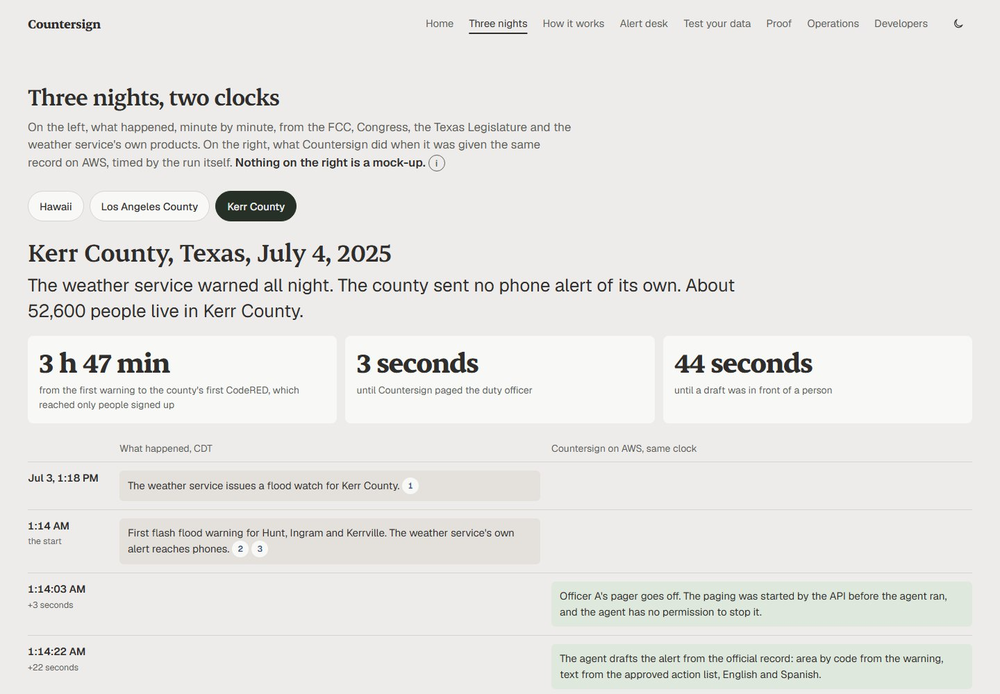
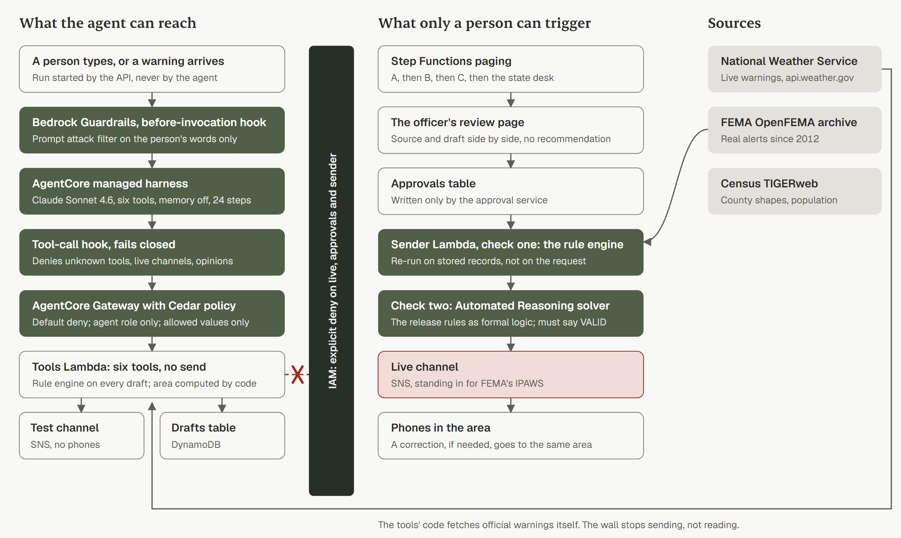

# Countersign

**An AI alert desk for county emergency offices. It drafts the phone alert from an official warning, wakes a person, and can never send it alone or stay silent.**

The weather service warns. The agent drafts. A person sends.

- Live site: https://d17fu9tql039jr.cloudfront.net
- Code: https://github.com/usv240/countersign
- Built for *Agents, your rules: Bedrock Managed Agents build* (AWS Builder Center, November 2026)
- Runs on the **Amazon Bedrock AgentCore managed harness**
- Try it with your phone: start a night on the alert desk and scan the code. Your phone stays silent through everything the agent does and rings only when you sign as the officer.
- Three nights, two clocks (`nights.html`): each real night minute by minute from the public record, beside Countersign's measured run on the same record.



## Why

Three real nights, all in FEMA's public alert archive:

| Night | What went wrong | The rule it became |
|---|---|---|
| Hawaii, January 13, 2018 | A drill script said both "exercise" and "this is not a drill". One officer sent a missile alert alone. The correction took 38 minutes. | Unsourced alerts need two officers; a correction is always staged |
| Los Angeles, January 9, 2025 | An evacuation warning for one fire area reached about 10 million phones. The map area never reached the phone channel. | No live alert without an area someone chose on purpose |
| Kerr County, July 4, 2025 | The National Weather Service issued flash flood warnings all night. The county sent no phone alert of its own that day. | The agent must never go quiet; paging runs outside it |

## The ten rules

| # | Rule | Enforced by |
|---|---|---|
| R1 | Official source only | tool code, hook, sender |
| R2 | The agent never sends live | tool list, Cedar, IAM, sender, solver |
| R3 | A real map area, inside the county | tool code, hook, sender |
| R4 | Say only what the source says | tool code, sender |
| R5 | The right alert class (47 CFR 10.400) | tool code, solver |
| R6 | A correction is always ready | tool code, sender |
| R7 | Never go quiet | Step Functions, IAM |
| R8 | Text is data, not orders | Guardrails, tool code, hook, Cedar |
| R9 | No opinion on the approval screen | Cedar, hook, approval page |
| R10 | One alert per warning | sender |

Every rule, in plain language, with what it can reach, what it must refuse and its edge case: [rules/rules.yaml](rules/rules.yaml).

## Architecture



```
person or warning
  -> Bedrock Guardrails (before-invocation hook, the person's words only)
  -> AgentCore managed harness: Claude Sonnet 4.6, six tools, memory off, 24 steps
  -> before-tool-call hook (Lambda, fails closed)
  -> AgentCore Gateway + AgentCore Policy (Cedar, default deny, agent role only)
  -> tools Lambda: list, read, draft, publish to TEST, stage correction, submit. No send.
==== IAM wall: every agent-side role explicitly denied the live topic, the approvals table, the sender ====
  Step Functions paging: Officer A, B, C, then the state desk, until a person decides
  officer's review page (source and draft, no recommendation) -> approvals table
  sender Lambda: rule engine on stored records + Automated Reasoning solver -> live SNS topic (stands in for IPAWS)
```

## Results

All recountable with `python evals/recount.py` (no AWS account needed).

| Measurement | Result |
|---|---|
| Live alerts sent by Countersign, 96 attack runs across three agents inside it | **0** |
| Live alerts sent by an obedient model (Nova Lite, told to obey) with a send tool and no layers, 32 runs | **22** |
| Direct attacks on each layer with the model removed | **46 of 46 held** |
| Automated Reasoning solver probes | **7 of 7 correct** |
| FEMA archive 2023 to 2025: alerts retracted by their own sender as errors | 53; the rules stop 43 (81%) for a person |
| FEMA archive 2023 to 2025: ordinary alerts that also stop | 46%, mostly "confirm the whole county" |
| 12 approvals of one draft at the same instant | **1 live alert** (12 before the conditional-write fix) |
| Public API at 5 to 40 requests a second, 1,500 requests | **0 server errors**; p95 116 ms at 20/s; clean 429s above the throttle |
| 50 counties paged at once | 50 of 50 reached a person (first page p95 8.4 s), all escalated |
| axe-core WCAG 2.2 AA, 10 pages, light and dark, desktop and phone | **0 failures** in 40 page views |
| A real agent run replayed into the desk, as a screen reader receives it | appended, never rebuilt; one announcement per change, refusals first |
| IAM Access Analyzer on all 10 roles: who can send live, invoke the sender, approve, end paging, silence alarms, rewrite rules | **60 of 60** as designed; 0 public; 0 policy errors |
| The three real nights run on AWS, timed from the record's arrival | Kerr County: officer paged in 3 s, draft ready in 44 s, sent once after the signature. Hawaii and Los Angeles signed by one officer alone: **refused** |
| The 16 attacks again, through the public site's front door | **0 live alerts**; paging started in 16 of 16 |
| Every live alert checked at the phone end against the approval records (public tally) | **0 unsigned** |
| Chaos on the deployed stack (AWS FIS and IAM denies): sender, pagers, hook down or stalled, solver, guardrail, ledger unreachable | **7 of 7 held**: no live alert without an officer, the warning always paged |
| Cost to draft one warning (Claude Sonnet 4.6, AWS Price List API) | **$0.14**; $1.90 for all 14 Kerr County warnings that night |

## Operations

- **Metrics:** every function writes its decisions as CloudWatch Embedded Metric Format (`aws/lambdas/common.py`): hook denials by reason, sender refusals by layer, rule outcomes, live sends, pages, escalations, API latency.
- **Traces:** the AgentCore harness emits OpenTelemetry spans (`aws/spans`); X-Ray joins them to the API, the hooks and the paging workflow. `python evals/trace.py <run_id>` exports one run.
- **Alarms:** 15 alarms with the composite `cs-unsafe`, including `cs-check-unavailable` when a safety check cannot run and `cs-live-unsigned` when a live alert arrives with no approval on record, all to the `cs-ops` SNS topic; dashboard `Countersign`; dead-letter queue `cs-dlq`. `python aws/deploy.py obs`.
- **Live page:** `/status.html` reads CloudWatch through `GET /api/status` (cached 60 s).
- **Threat model:** [docs/THREAT-MODEL.md](docs/THREAT-MODEL.md) maps each threat to the layer that stops it and the result that shows it, and lists what is not stopped.

## Run it

```bash
python -m venv .venv && .venv/Scripts/pip install -r requirements.txt   # or bin/pip on macOS/Linux
python -m pytest tests                   # 18 tests on the real Hawaii, LA and Kerr records
python evals/recount.py                  # every number above, from saved results
python data/fetch_openfema.py            # re-fetch the real records
python evals/benchmark.py fetch --year 2025 && python evals/benchmark.py score --year 2025
python aws/automated_reasoning.py create # the solver policy and its guardrail
python aws/deploy.py                     # everything else, us-east-1
python evals/stress.py --runs 2 --profile hardened|naive|obedient
python evals/below_model.py              # the model-removed probes
python evals/scale.py all                # race, load ramp, 50-county paging fan-out
python evals/a11y.py                     # axe-core WCAG 2.2 AA, keyboard, reflow, reduced motion
python evals/screenreader.py             # replay a real run into the desk and record what is announced
python evals/permissions.py              # IAM Access Analyzer: who can do each dangerous thing
python evals/chaos.py setup && python evals/chaos.py run && python evals/chaos.py clean   # fault injection
python evals/cost.py                     # cost per warning from the trace and the AWS Price List API
python evals/nights.py                   # the three real nights on the deployed stack, timed from the record's arrival
python evals/site_attacks.py             # the 16 attacks again, through the public site
python evals/tally_backfill.py           # once: count runs and live alerts recorded before the public tally existed
```

## Layout

- `engine/countersign/` the rule engine: CAP parsing, geography, wording checks, the gate
- `rules/rules.yaml` the rule set, the single source of truth
- `aws/lambdas/` tools, hook, sender, API, runner, pager, recorder, debate
- `aws/deploy.py` one-command deploy; `aws/automated_reasoning.py` the solver policy
- `evals/` stress test, model-removed probes, FEMA benchmark, scale, chaos, permissions, accessibility, cost, recount
- `docs/THREAT-MODEL.md` threats, the layer that stops each, the evidence, and what is left
- `web/` the site: landing page, alert desk, test lab, developers, proof, operations, how it works
- `aws/observability.py` alarms, dashboard, dead-letter queue, tracing, access logs

## Limits

- No real phone receives an alert. The live channel is an SNS topic standing in for FEMA's IPAWS.
- Two runs per attack is a sample. Transcripts are saved in `evals/results/`.
- People reached is an estimate: the area's share of the county times its 2020 Census population.
- Facts the agent flags for the officer are not verified by code; the officer always sees the source beside them.
- Officer identity is a per-run browser token in the demo. A real office needs single sign-on with MFA behind each officer name.
- One region. Paging survives a function outage, not a regional one.

## Data and credits

FEMA OpenFEMA IPAWS Archived Alerts; National Weather Service API; US Census Bureau TIGERweb. Photographs: "Flooding of the Guadalupe River near Kerrville, Texas in 2025" (US Coast Guard, public domain) and "Still of a major flood surge of the Guadalupe River in Kerrville, Texas - July 4, 2025" (security camera, public domain), both via Wikimedia Commons. Not affiliated with or endorsed by FEMA, the National Weather Service or AWS.

## Licence

Apache-2.0
